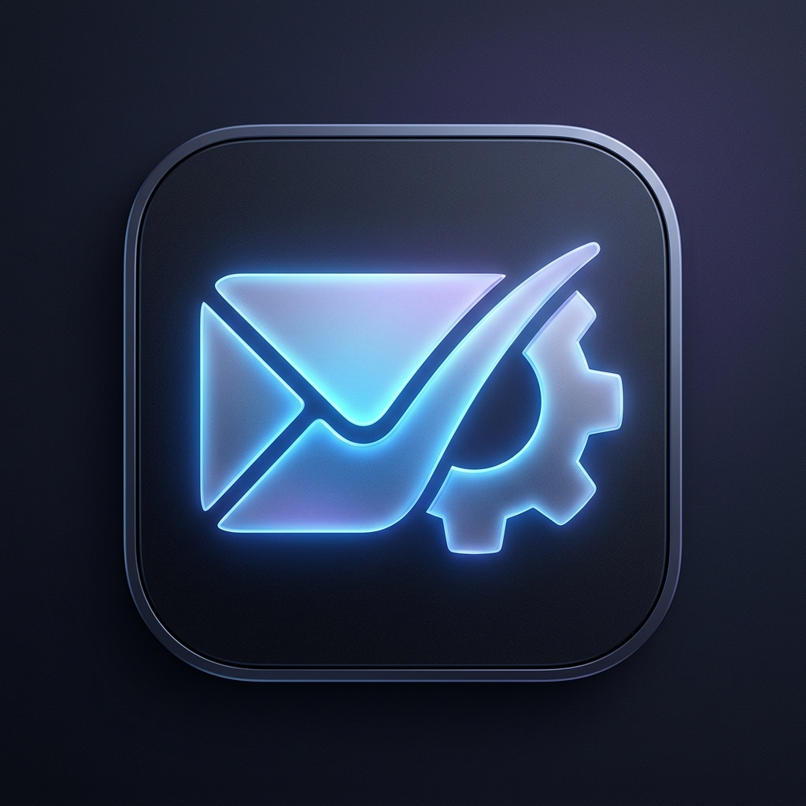
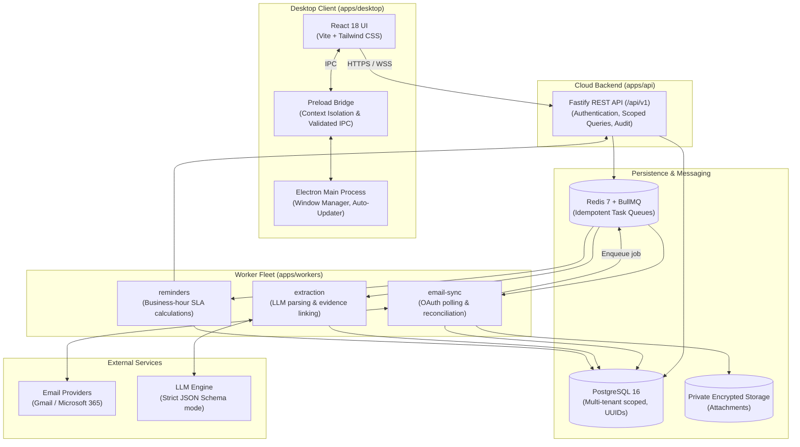
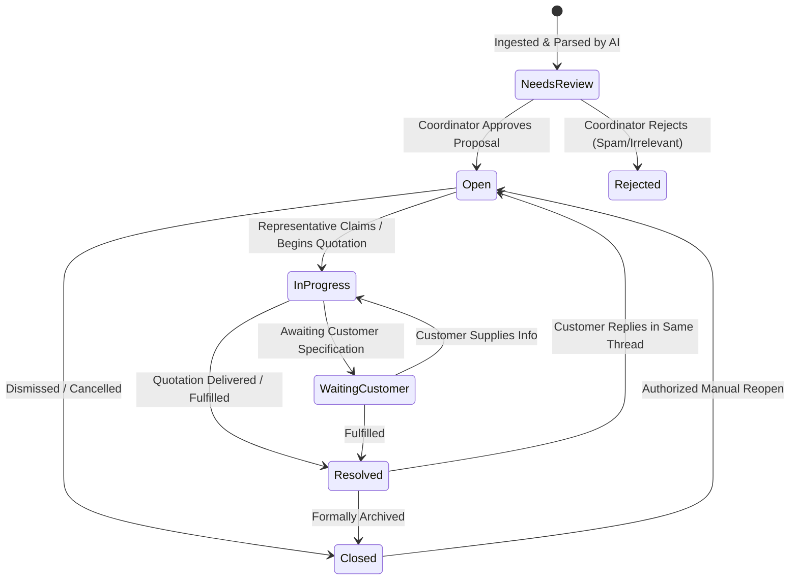

<div align="center">



# 📬 InboxOps
### *Email-to-Action Automation for B2B Sales & Quotation Teams*

Turn chaotic business email enquiries into evidence-backed cases, assigned tasks, trackable deadlines, and auditable outcomes.

[](https://hrithik1881.github.io/InboxOps-Email-to-Action-Automation/)
[](https://www.typescriptlang.org/)
[](https://www.electronjs.org/)
[](https://react.dev/)
[](https://fastify.dev/)
[](https://www.postgresql.org/)
[](https://redis.io/)
[](https://tailwindcss.com/)
[](./LICENSE)
[](./.github/workflows/ci.yml)

**[🌐 Visit Live Landing Page & Interactive Preview](https://hrithik1881.github.io/InboxOps-Email-to-Action-Automation/)**

[Live Website](https://hrithik1881.github.io/InboxOps-Email-to-Action-Automation/) •
[System Architecture](#-system-architecture) •
[Core Features](#-core-capabilities) •
[Project Structure](#-monorepo-structure) •
[Quickstart](#-getting-started) •
[State Machine](#-case-lifecycle--state-model) •
[Security Model](#-security--threat-model) •
[Roadmap](#-10-step-build-order)

---
</div>

## 💡 Overview

Small B2B quotation and sales teams lose revenue every day when high-value customer inquiries get buried in inbox clutter, dropped during handoffs, or forgotten without strict follow-up tracking.

**InboxOps** provides an operational backbone that bridges email and sales fulfillment:
- **Desktop First**: A fast Windows desktop application (Electron + React) designed for sales coordinators and quotation executives.
- **Hosted Resilience**: Independent cloud background workers (Redis + BullMQ) that process inboxes, calculate SLAs, and schedule reminders even when client workstations are shut down.
- **Evidence-Backed AI**: AI classifies emails and extracts line items, quantities, and requested deadlines—citing exact character spans and document coordinates so humans never have to guess.
- **Human-in-the-Loop**: AI proposes; humans review, correct, and approve. Zero autonomous outbound emails or commercial commitments without human authorization.

> 🌐 **Interactive Landing Page & Live App Preview**: Experience the animated, Apple-grade interface and simulate the AI review queue in your browser:  
> **[https://hrithik1881.github.io/InboxOps-Email-to-Action-Automation/](https://hrithik1881.github.io/InboxOps-Email-to-Action-Automation/)**

---

## ⚡ Core Capabilities

```
+------------------------------------------------------------------------------------------------+
|                                    INBOXOPS CORE CAPABILITIES                                  |
+--------------------------------+-------------------------------+-------------------------------+
|  📥 Smart Mailbox Sync         |  🤖 Evidence-Cited AI         |  👥 Human-in-the-Loop Queue   |
|  * Google & Microsoft OAuth    |  * Quotation/enquiry parser   |  * Split-pane review UI       |
|  * Folder-selective ingestion  |  * Item, qty, deadline parser |  * One-click approve/edit     |
|  * Replay-safe deduplication   |  * Source text & cell citation|  * Reject or defer spam/dupes |
+--------------------------------+-------------------------------+-------------------------------+
|  📋 Case & Task Tracking       |  ⏰ SLA & Overdue Engine      |  🔒 Enterprise-Grade Security |
|  * Multi-message case linking  |  * Dual deadline semantics    |  * Strict multi-tenant bounds |
|  * Assignee & next-action tracking | * Timezone & business hours   | * Prompt injection defenses   |
|  * Thread auto-reopen on reply |  * Derived overdue indicators |  * Tamper-evident audit trail |
+--------------------------------+-------------------------------+-------------------------------+
```

1. **Ingestion & Idempotent Deduplication**: Connects to Gmail or Microsoft 365 via OAuth2. Deduplicates incoming messages using compound `(account_id, provider_message_id)` keys to guarantee replay safety.
2. **Deterministic & AI Extraction**: Identifies buyer info, RFQ references, item details, quantities, and explicit customer deadlines. Automatically links extracted values directly to source text spans.
3. **Review Queue**: High-velocity split-pane desktop interface allowing coordinators to inspect proposed records side-by-side with raw email text, verify citations, and approve or adjust fields with full keyboard shortcuts.
4. **Case & Task Execution**: Automatically provisions cases with explicit owners, internal SLAs, and customer deadlines. Prevents silent concurrent overwrites using optimistic concurrency locking (`version` checks).
5. **Thread-Aware Continuity**: Intelligently correlates incoming customer replies back to existing cases using email thread IDs and `In-Reply-To` headers, re-opening resolved cases when customers supply updates.
6. **Operational Visibility**: Built-in executive dashboard tracking first-response times, time-to-quote, open bottlenecks, overdue counts, and assignment health.

---

## 🏛 System Architecture

InboxOps is architected as a modular monorepo cleanly separating desktop presentation, authenticated API services, and resilient asynchronous worker queues.



---

## 🔄 Case Lifecycle & State Model

Cases traverse a strict, auditable state machine:



> **Note on Deadlines**: Overdue status is an **aggregate derived condition**, not a raw database state. A case can be `InProgress` and overdue concurrently, governed by `customer_deadline` vs `internal_due_at` calculated against workspace business hours.

---

## 📁 Monorepo Structure

The codebase is organized in an enterprise monorepo adhering strictly to Section 18 of the project specification:

```
inboxops/
├── apps/
│   ├── desktop/              # Electron main, preload bridge, React 18 renderer
│   ├── api/                  # Authenticated Fastify REST API (/api/v1)
│   └── workers/              # Asynchronous Redis/BullMQ worker processes
│       ├── email-sync/       # Mailbox OAuth ingestion, deduplication & reconciliation
│       ├── extraction/       # AI document parsing, schema validation & evidence linking
│       └── reminders/        # Business-hour SLA calculations & overdue escalations
├── packages/
│   ├── shared-types/         # Shared TypeScript DTOs, domain models, and API interfaces
│   ├── validation/           # Zod runtime schemas & deterministic business validation
│   └── ui/                   # Reusable accessible design system & UI primitives
├── database/
│   ├── migrations/           # Multi-tenant PostgreSQL database migrations
│   └── seeds/                # Synthetic email datasets & local development seeders
├── tests/
│   ├── unit/                 # Unit tests (math, state transitions, validation)
│   ├── integration/          # API, database transactions, queue lifecycles
│   ├── e2e/                  # Desktop & end-to-end user journey tests (Playwright)
│   └── security/             # Cross-tenant data isolation & prompt injection tests
├── docs/                     # Architectural & specification documentation suite
│   ├── product-spec.md       # Full product specification
│   ├── architecture.md       # Deep-dive architecture and component breakdown
│   ├── data-model.md         # Complete database entity schema & relationships
│   ├── api-specification.md  # REST API routes, schemas, and error conventions
│   ├── security-threat-model.md # Threat mitigations & security boundaries
│   └── build-order-roadmap.md# 10-step implementation plan & Definition of Done
├── .github/
│   ├── workflows/ci.yml      # CI lint, typecheck, and test pipeline
│   ├── ISSUE_TEMPLATE/       # Structured bug report & feature request templates
│   └── pull_request_template.md # PR validation checklist
├── .env.example              # Environment variables template
├── .editorconfig             # Cross-editor formatting configuration
├── .gitignore                # Production git ignore definitions
└── LICENSE                   # MIT License
```

---

## 🛠 Tech Stack

| Domain | Technology | Justification |
| :--- | :--- | :--- |
| **Desktop Application** | [Electron](https://www.electronjs.org/) + [React](https://react.dev/) + [Vite](https://vitejs.dev/) | Cross-platform desktop runtime, blazing-fast HMR, rich local OS capabilities |
| **Design & UI** | [Tailwind CSS](https://tailwindcss.com/) + [Radix UI](https://www.radix-ui.com/) | Accessible keyboard navigation, zero-runtime CSS, customizable dark/light themes |
| **Backend API** | [Node.js](https://nodejs.org/) (v20 LTS) + [Fastify](https://fastify.dev/) | High-performance, schema-driven REST API with low memory footprint |
| **Database** | [PostgreSQL](https://www.postgresql.org/) (16+) | Rock-solid ACID transactions, row-level multi-tenancy, native JSONB |
| **ORM / Migrations** | [Prisma](https://www.prisma.io/) or [Drizzle ORM](https://orm.drizzle.team/) | End-to-end type safety, automated migrations, strict relational integrity |
| **Job Queue** | [Redis](https://redis.io/) + [BullMQ](https://bullmq.io/) | Enterprise-grade job retry backoffs, deduplication, and scheduled crons |
| **AI / Document Extraction** | LLM Structured Output + Zod | Strict schema validation with evidence citation; no arbitrary model hallucinations |
| **Testing** | [Vitest](https://vitest.dev/) + [Playwright](https://playwright.dev/) | Lightning fast unit testing and robust desktop UI end-to-end automation |

---

## 🚀 Getting Started

### Prerequisites
- **Node.js**: `v20.x` or higher (LTS recommended)
- **Package Manager**: `npm` (v10+) or `pnpm`
- **PostgreSQL**: `v16+` (or Docker container)
- **Redis**: `v7+` (or Docker container)

### 1. Clone the Repository
```bash
git clone https://github.com/Hrithik1881/InboxOps-Email-to-Action-Automation.git
cd InboxOps-Email-to-Action-Automation
```

### 2. Environment Setup
Copy the configuration template and customize your local secrets:
```bash
cp .env.example .env
```

### 3. Local Development with Mock Fixtures
InboxOps is designed to run locally **without requiring live email accounts or paid AI endpoints**:
- Set `EMAIL_PROVIDER_MODE=mock` in `.env` to ingest synthetic email fixtures from `database/seeds/synthetic-emails/`.
- Set `AI_PROVIDER=mock` to test instant deterministic extraction matching the schema.

---

## 🔒 Security & Threat Model

InboxOps processes sensitive corporate communication. Security is engineered from day one:

- **Zero-Trust Input Processing**: Ingested email bodies and attachments are parsed strictly as **passive data**, never as executable prompts. System instructions are segregated to prevent prompt-injection attacks.
- **Tenant Isolation**: Every database operation and API route explicitly filters by the authenticated user's `organization_id`. Cross-tenant queries are blocked at the database and application levels.
- **Safe Attachment Sandboxing**: Uploaded files undergo strict MIME allow-listing and are parsed in isolated worker subprocesses with CPU/memory limits. Executables and macros are blocked.
- **Optimistic Locking**: Prevents simultaneous edit conflicts between staff members. If two sales coordinators claim or modify a case concurrently, the out-of-date client receives a clean `CASE_VERSION_CONFLICT` exception.
- **Tamper-Evident Audit Trail**: Every assignment, status change, proposal approval, and field edit is recorded in an immutable `AuditEvent` log.

For complete threat mitigations and security architecture, see [docs/security-threat-model.md](./docs/security-threat-model.md).

---

## 📈 10-Step Build Order

InboxOps follows a structured, milestone-driven build plan to ensure stable progressive delivery:

1. **Phase 1: Repository Foundation & Synthetic Seed Fixtures** *(Current)*
2. **Phase 2: Desktop UI Prototyping** (Electron + React review queue & case flows)
3. **Phase 3: Database Models & Multi-Tenant Authorization**
4. **Phase 4: Case & Task Management Engine** (State machine, assignments, optimistic locking)
5. **Phase 5: Email Provider Integration** (OAuth2 connector for Gmail or Microsoft 365)
6. **Phase 6: Ingestion Queue, Deduplication & Reconciliation** (Redis + BullMQ)
7. **Phase 7: AI Extraction, Evidence Citation & Review Queue Integration**
8. **Phase 8: Business-Hour SLA Reminders & Reporting Metrics**
9. **Phase 9: Sandboxed Attachment & OCR Parsing**
10. **Phase 10: Security Hardening, Windows Installer Packaging & Pilot Launch**

---

## 📚 Documentation Index

Deep dive into the full documentation suite located in [`docs/`](./docs):
- 📄 [Product Specification Baseline](./docs/product-spec.md)
- 🏗 [System Architecture & Components](./docs/architecture.md)
- 🗄 [Data Model & Schema Relationships](./docs/data-model.md)
- 🌐 [REST API Specification (`/api/v1`)](./docs/api-specification.md)
- 🛡 [Security Architecture & Threat Model](./docs/security-threat-model.md)
- 🗺 [Build Order Roadmap & Definition of Done](./docs/build-order-roadmap.md)

---

## 👥 Contributing & Standards

1. Check open issues or review the [Build Order Roadmap](./docs/build-order-roadmap.md).
2. Follow strict tenant scoping (`organization_id`) across all queries.
3. Ensure background jobs include idempotent replay keys.
4. Run linting, type checking, and tests prior to opening a PR.

---

## 📄 License

This project is licensed under the [MIT License](./LICENSE) &copy; 2026 Hrithik / InboxOps Team.
