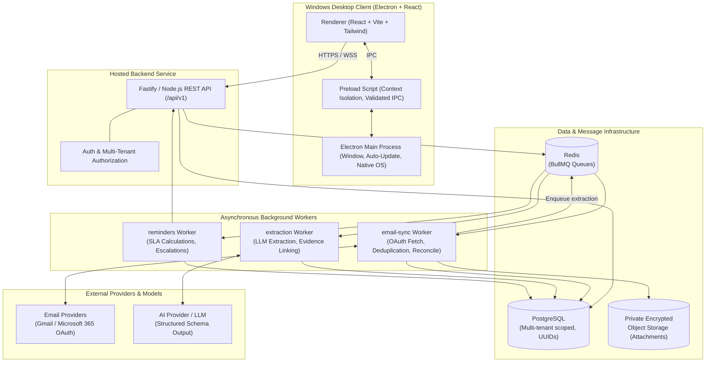

# InboxOps System Architecture

## 1. High-Level Architectural Diagram

---

## 2. Component Boundaries & Responsibilities

### 2.1 Windows Desktop Application (`apps/desktop`)
- **Process Isolation Model**:
  - `Renderer Process`: Sandboxed web page rendering React UI. Has **no** direct access to Node.js APIs or native OS capabilities.
  - `Preload Script`: Selectively exposes an immutable `window.inboxOpsAPI` object containing strongly-typed, channel-safe invocation wrappers.
  - `Main Process`: Orchestrates window lifecycle, native notifications, secure credential caching, and desktop packaging (via `electron-builder`).
- **Offline / Caching Resilience**: The desktop client maintains a local query cache using TanStack Query, presenting cached data instantaneously while verifying freshness against `/api/v1`.

### 2.2 Hosted Backend REST API (`apps/api`)
- Built as a **modular monolith** using Fastify/TypeScript. Avoids premature microservice overhead while enforcing strict domain module boundaries.
- **Organization-Scoped Multitenancy**: Every query and mutation is strictly filtered by the authenticated user's `organization_id`.
- **Concurrency & Versioning**: Employs optimistic concurrency checks via entity `version` integers. If two team members edit or claim a case simultaneously, the slower request receives an explicit HTTP 409 `CASE_VERSION_CONFLICT`.

### 2.3 Background Queue & Workers (`apps/workers`)
- Powered by **Redis** and **BullMQ**.
- Background jobs are fully idempotent:
  - Jobs are tagged with deterministic `idempotency_key` values.
  - Exponential backoff with jitter is applied to transient provider rate limits.
  - Failures are captured in dead-letter queues with clear operator visibility.

---

## 3. Technology Stack Reference

| Layer | Selected Technology | Architecture Rationale |
| :--- | :--- | :--- |
| **Desktop Shell** | Electron (v30+) | Native Windows distribution, OS notifications, auto-updater |
| **Desktop UI** | React 18 + Vite + TypeScript | Lightning-fast HMR, component reusability, type safety |
| **Design System** | Tailwind CSS + Radix UI | Accessible keyboard navigation, customized high-contrast themes |
| **API Server** | Node.js (v20 LTS) + Fastify | Ultra-low overhead, native JSON schema validation |
| **Database** | PostgreSQL 16+ | ACID compliance, JSONB support, row-level multi-tenancy |
| **ORM / Query Builder**| Prisma or Drizzle ORM | Type-safe queries, migration automation |
| **Job Queue** | Redis 7 + BullMQ | Robust retry semantics, scheduled jobs, delayed reminders |
| **AI Integration** | Anthropic Claude / OpenAI | Structured JSON output mode with strict schema enforcement |
| **Document Parsing** | pdf-parse, xlsx, Tesseract OCR | Sandboxed worker parsing without macro execution risks |
| **Testing** | Vitest + Playwright | Unit, integration, and E2E desktop test runner |
