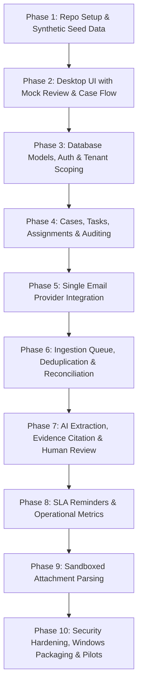

# InboxOps Build Order & Implementation Roadmap

## 1. Ten-Step Build Sequence

### Phase Details

#### Phase 1: Repository Foundation, Tooling & Synthetic Fixtures
- Establish monorepo workspace (`apps/`, `packages/`, `database/`, `tests/`).
- Setup shared TypeScript configurations, ESLint, and Prettier.
- Create realistic synthetic email fixtures (quotation requests, multipart attachments, RFQs, thread replies).

#### Phase 2: Desktop UI Prototyping (Mocked Workflows)
- Implement Electron shell with React + Tailwind.
- Build Overview Dashboard, Review Queue split-pane, Case Detail view with timeline, and responsive Action List.
- Verify full keyboard navigation, accessible focus states, and high-contrast styling.

#### Phase 3: Database Persistence, Multi-Tenancy & Auth
- Author PostgreSQL migrations for Organization, User, Case, EmailMessage, and ExtractedField entities.
- Implement server-side multi-tenant authorization (`organization_id` scoping).
- Implement JWT session management and user role enforcement.

#### Phase 4: Case & Task Management Engine
- Implement state transitions (`NeedsReview` -> `Open` -> `InProgress` -> `WaitingCustomer` -> `Resolved` -> `Closed`).
- Implement optimistic concurrency locking (`version` check).
- Implement immutable audit logging for all critical mutations.

#### Phase 5: Email Provider Integration
- Build OAuth2 connector for first provider (Gmail or Microsoft 365 based on pilot feedback).
- Implement mailbox folder subscription and webhook reception.

#### Phase 6: Asynchronous Ingestion & Queue Pipeline
- Implement Redis + BullMQ workers for `email-sync`.
- Implement deduplication using `(account_id, provider_message_id)`.
- Implement periodic reconciliation to recover dropped messages.

#### Phase 7: AI Extraction & Review Queue Integration
- Implement LLM structured output parsing with rigid Zod schema validation.
- Implement source evidence citation linking extracted values to specific email character spans.
- Wire up the Desktop Review Queue to approve, edit, reject, and defer proposals.

#### Phase 8: SLA Reminders & Operational Reporting
- Implement `reminders` worker to track business hours and workspace timezones.
- Calculate derived `is_overdue` state without altering customer deadlines.
- Generate operational reporting dashboards (First Response Time, Time to Quote).

#### Phase 9: Attachment Processing
- Implement sandboxed parsing of PDF and spreadsheet attachments with OCR fallback.
- Enforce strict MIME allow-listing and resource quotas.

#### Phase 10: Packaging, Security Validation & Pilot Rollout
- Configure `electron-builder` Windows installer (NSIS) and code signing pipeline.
- Execute security regression tests (cross-tenant access denial, prompt-injection defenses).
- Validate with pilot customer cohort.

---

## 2. Definition of Done (DoD)
A feature or phase is marked complete **only** when all of the following criteria are fulfilled:
1. **Requirements Satisfied**: All specified functional rules are met.
2. **UI & Accessibility**: Responsive layout, empty states, loading states, error handling, keyboard accessible.
3. **Backend Authorization**: Multi-tenant `organization_id` scoping enforced strictly server-side.
4. **Data Integrity & Concurrency**: Optimistic concurrency locking and transactional consistency in place.
5. **Auditing**: All mutations produce tamper-evident audit records.
6. **Automated Tests**: Unit and integration test coverage passing in CI.
7. **Documentation**: Corresponding API endpoints and architectural docs updated.
