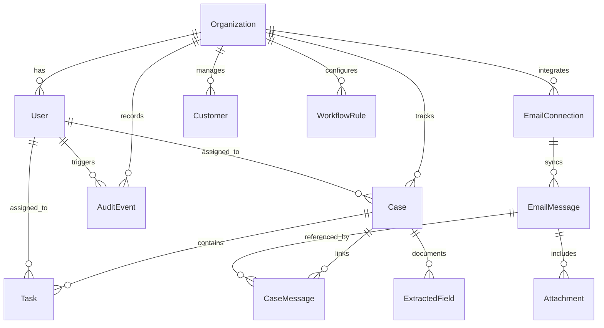
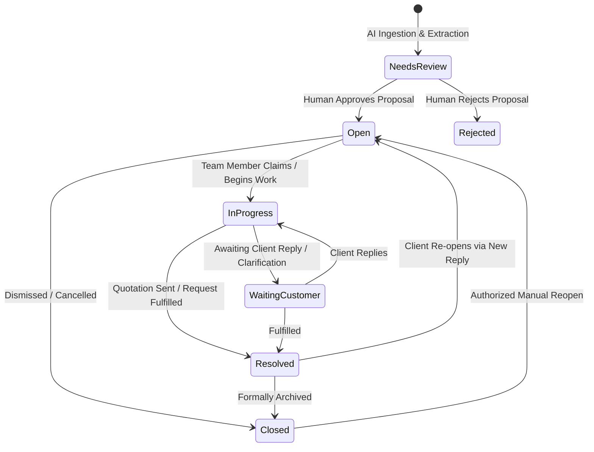

# InboxOps Data Model & Schema Specification

## 1. Entity Relationship Overview

InboxOps uses a multi-tenant relational architecture powered by PostgreSQL. Every record that belongs to a customer tenant explicitly references `organization_id`.

---

## 2. Core Entities & Field Definitions

### 2.1 `Organization`
The tenant boundary. All data is scoped here.
- `id` (UUID, Primary Key)
- `name` (VARCHAR 255)
- `timezone` (VARCHAR 64, e.g. `'Asia/Kolkata'`, `'America/New_York'`)
- `plan_tier` (ENUM: `solo`, `team`, `business`)
- `retention_days` (INTEGER, default 365)
- `created_at` (TIMESTAMPTZ)
- `updated_at` (TIMESTAMPTZ)

### 2.2 `User`
Staff members belonging to an organization.
- `id` (UUID, Primary Key)
- `organization_id` (UUID, Foreign Key -> `Organization.id`)
- `email` (VARCHAR 255, Unique per organization)
- `display_name` (VARCHAR 255)
- `role` (ENUM: `owner`, `admin`, `manager`, `member`, `read_only`)
- `status` (ENUM: `active`, `invited`, `suspended`)
- `created_at` (TIMESTAMPTZ)

### 2.3 `EmailConnection`
OAuth mailbox credentials and synchronization state.
- `id` (UUID, Primary Key)
- `organization_id` (UUID, Foreign Key)
- `provider` (ENUM: `google`, `microsoft`)
- `account_email` (VARCHAR 255)
- `refresh_token_encrypted` (TEXT)
- `scopes` (TEXT[])
- `sync_cursor` (TEXT)
- `sync_status` (ENUM: `active`, `rate_limited`, `revoked`, `error`)
- `last_successful_sync_at` (TIMESTAMPTZ)
- `last_error` (TEXT)

### 2.4 `EmailMessage`
Immutable representation of an ingested email.
- `id` (UUID, Primary Key)
- `connection_id` (UUID, Foreign Key -> `EmailConnection.id`)
- `provider_message_id` (VARCHAR 255, Unique with `connection_id`)
- `thread_id` (VARCHAR 255)
- `sender` (JSONB: `{ name, email }`)
- `recipients` (JSONB: `{ to: [], cc: [], bcc: [] }`)
- `subject` (TEXT)
- `received_at` (TIMESTAMPTZ)
- `body_text_storage_key` (TEXT)
- `raw_headers` (JSONB)

### 2.5 `Case`
The central business record tracking an inquiry or quotation commitment.
- `id` (UUID, Primary Key)
- `organization_id` (UUID, Foreign Key)
- `customer_id` (UUID, Foreign Key -> `Customer.id`, Nullable)
- `case_number` (VARCHAR 32, Stable human-readable e.g. `CASE-2026-0042`)
- `type` (ENUM: `quotation_request`, `sales_enquiry`, `general`)
- `status` (ENUM: `NeedsReview`, `Open`, `InProgress`, `WaitingCustomer`, `Resolved`, `Closed`, `Rejected`)
- `priority` (ENUM: `low`, `medium`, `high`, `urgent`)
- `owner_id` (UUID, Foreign Key -> `User.id`, Nullable)
- `customer_deadline` (TIMESTAMPTZ, Nullable)
- `internal_due_at` (TIMESTAMPTZ, Nullable)
- `follow_up_at` (TIMESTAMPTZ, Nullable)
- `resolved_at` (TIMESTAMPTZ, Nullable)
- `resolution_reason` (TEXT, Nullable)
- `version` (INTEGER, Optimistic locking counter)
- `created_at` (TIMESTAMPTZ)
- `updated_at` (TIMESTAMPTZ)

### 2.6 `ExtractedField`
Field-level AI extractions linked to source evidence.
- `id` (UUID, Primary Key)
- `case_id` (UUID, Foreign Key -> `Case.id`)
- `email_message_id` (UUID, Foreign Key -> `EmailMessage.id`)
- `field_name` (VARCHAR 64, e.g. `'requested_quantity'`, `'part_number'`, `'deadline'`)
- `extracted_value` (JSONB)
- `corrected_value` (JSONB, Nullable)
- `confidence_score` (FLOAT)
- `evidence_text` (TEXT)
- `evidence_location` (JSONB: `{ page, cell, char_start, char_end }`)
- `review_status` (ENUM: `pending`, `accepted`, `corrected`, `rejected`)
- `reviewer_id` (UUID, Foreign Key -> `User.id`, Nullable)

### 2.7 `Task`
Discrete sub-actions required to complete a case.
- `id` (UUID, Primary Key)
- `case_id` (UUID, Foreign Key -> `Case.id`)
- `assignee_id` (UUID, Foreign Key -> `User.id`, Nullable)
- `title` (VARCHAR 255)
- `status` (ENUM: `pending`, `in_progress`, `completed`, `cancelled`)
- `due_at` (TIMESTAMPTZ, Nullable)
- `completion_evidence` (TEXT, Nullable)
- `created_at` (TIMESTAMPTZ)

### 2.8 `AuditEvent`
Append-only tamper-evident audit history.
- `id` (UUID, Primary Key)
- `organization_id` (UUID, Foreign Key)
- `actor_id` (UUID, Nullable if system event)
- `entity_type` (VARCHAR 64, e.g. `'Case'`, `'EmailConnection'`)
- `entity_id` (UUID)
- `action` (VARCHAR 64, e.g. `'case.assigned'`, `'proposal.approved'`)
- `metadata` (JSONB)
- `created_at` (TIMESTAMPTZ)

---

## 3. Case State Machine

